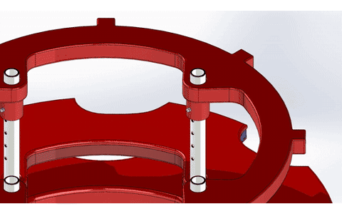
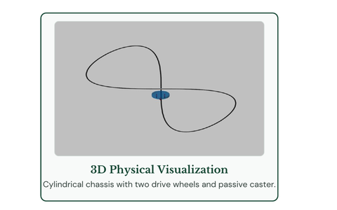
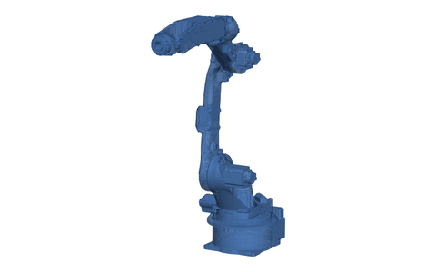
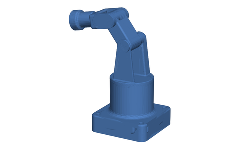
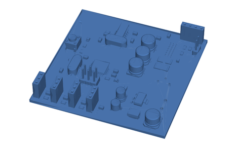
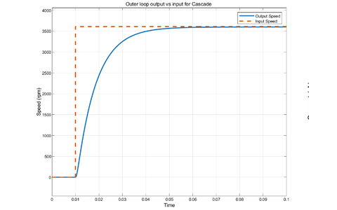
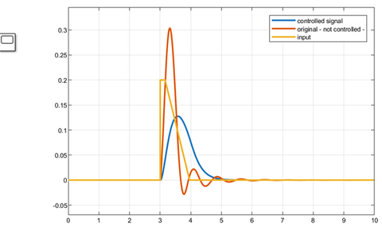
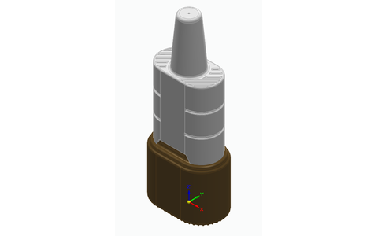

# Mohammed Emad Said

**Mechatronics engineering student at the University of Debrecen, graduating January 2027.**
I design parts and mechanisms, build the control systems that drive them, and lay out the electronics in between, with hands-on quality and production experience from automotive lines.
Looking for engineering internships and trainee roles in Hungary (Debrecen or Budapest): mechatronics, design, controls, automation and quality.

  
  
  
  

---

### Selected projects

<table>
<tr>
<td width="50%" valign="top">

<b><a href="https://github.com/Mohammed-Emad-2004/Unilever-Challenge-Automated-Changeover-System">Automated changeover for a Unilever bottling line</a></b> 
Team THUNDER. We took a 2 h 24 min manual format changeover down to a projected 16 min by automating 97 setting points with stepper motors, redesigning the star wheel and grippers, and electrically separating the unscrambler. 
SolidWorks · mechanism design · automation concept · cost estimate
</td>
<td width="50%" valign="top">

<b><a href="https://github.com/Mohammed-Emad-2004/DDMR-PID-vs-StateSpace-Control-MATLAB-Simulink">PID vs. state-space control of a line-following robot</a></b> 
I built it up from kinematics to a full Simscape model with DC motors, an H-bridge and a non-ideal battery. Once those hardware limits were in the loop, PID had to drop to 0.30 m/s to stay stable, while the pole-placement controller held 0.40 m/s. 
MATLAB · Simulink · Simscape Multibody · observers · LQR
</td>
</tr>
<tr>
<td width="50%" valign="top">

<b><a href="https://github.com/Mohammed-Emad-2004/Yaskawa-GP25-Kinematics-Dynamics-Simscape">Yaskawa GP25: digital twin with motor-level joint control</a></b> 
CAD → URDF → Simscape. DH kinematics, IK, a circular trajectory, and inverse dynamics, then DC motors, gearboxes and six hand-tuned PID loops. I tracked down a unit-export bug that had inflated joint torques from about 1,066 Nm to 3,135 Nm. 
Onshape · Robotics System Toolbox · Simscape Multibody
</td>
<td width="50%" valign="top">

<b><a href="https://github.com/Mohammed-Emad-2004/3DOF-MiniArm-Robot-SolidEdge">3-DOF MiniArm manipulator</a></b> 
Sixteen custom parts in Solid Edge 2026, built around three Faulhaber 3242G motors with 66:1 / 43:1 / 14:1 planetary gearheads. It has a full drawing set, STL files for printing, and a torque check with safety factors above 2. 
Solid Edge · technical drawings · DFM for 3D printing
</td>
</tr>
</table>

#### More work

| | Project | What it shows |
|:-:|:--|:--|
|  | [Motor controller PCB](https://github.com/Mohammed-Emad-2004/CAXX-Motor-Driver-PCB-KiCad) | 2-layer KiCad board with an ATmega328P, CH340G USB, a DRV8825 dual H-bridge and a 5 V regulator, with power and logic nets kept separate. It's the board in the MiniArm base. |
|  | [DC motor modelling and drives](https://github.com/Mohammed-Emad-2004/DC-Motor-Modeling-and-Control-MATLAB-Simulink) | Speed, position and cascade control of the Faulhaber motor, plus a PWM inverter driving an induction motor in Simscape Electrical. |
|  | [Quarter-car active suspension](https://github.com/Mohammed-Emad-2004/Quarter-Car-Suspension-StateSpace-Control-MATLAB) | Pole placement (Ackermann) and a Luenberger observer rejecting a speed-bump disturbance. |
|  | [Medicine bottle reverse-modelling](https://github.com/Mohammed-Emad-2004/Medicine-Bottle-3D-Modeling-SolidEdge) | A real bottle and cap measured and modelled in Solid Edge, with drawings and model-vs-real comparison photos. |
| | [Pneumatic stepping chain](https://github.com/Mohammed-Emad-2004/Pneumatics-Stepping-Chain-FluidSIM) | (A+A−B+B−A+A−)×3 sequence in FluidSIM using the stepping-chain method. |

The MiniArm, the motor-control project and the PCB share the same Faulhaber motor. I characterised it, controlled it, designed an arm around it, and laid out the board that drives it.

---

### Currently working on

**B.Sc. thesis: PID vs. state-space path tracking for an autonomous mobile robot.** I'm validating both controllers in four layers: a Simulink kinematic model, a Simscape Multibody plant, ROS 2 / Gazebo software-in-the-loop, and real hardware (Raspberry Pi 5 + ESP32) with LiDAR/ultrasonic obstacle avoidance and Nav2.

---

### Experience

- **Customer Support Representative, transcosmos Europe (Fossil Group: watches & jewelry).** Part-time. First point of contact between customers and the repair center: e-commerce support and technical repair cases, handled in Salesforce and SAP.
- **Student work at Vitesco Technologies, thyssenkrupp and METRI Automotive.** Part-time on automotive production lines: technical cleanliness and quality checks, root-cause analysis, MES/SAP production data, process improvements.

### Toolkit

| | |
|:--|:--|
| **CAD & mechanical** | SolidWorks · Solid Edge · Onshape · technical drawings · STL / 3D printing |
| **Modelling & control** | MATLAB · Simulink · Simscape Multibody / Electrical · PID · pole placement · LQR · observers |
| **Robotics** | DH kinematics · inverse kinematics & dynamics · trajectory planning · ROS 2 · Gazebo |
| **Electronics & automation** | KiCad · ATmega / H-bridge drivers · PWM · FluidSIM pneumatics · LabVIEW |
| **Business systems** | SAP · Salesforce · MES |

**Certifications:** MathWorks MATLAB Onramp · Simulink Onramp · Control Design Onramp
